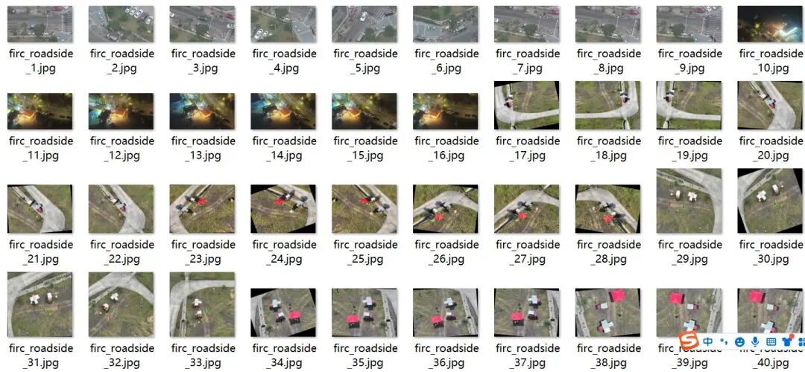
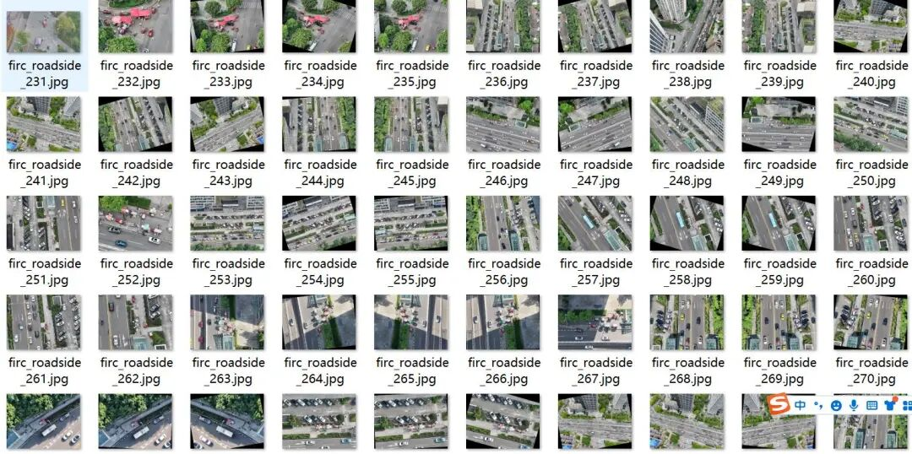
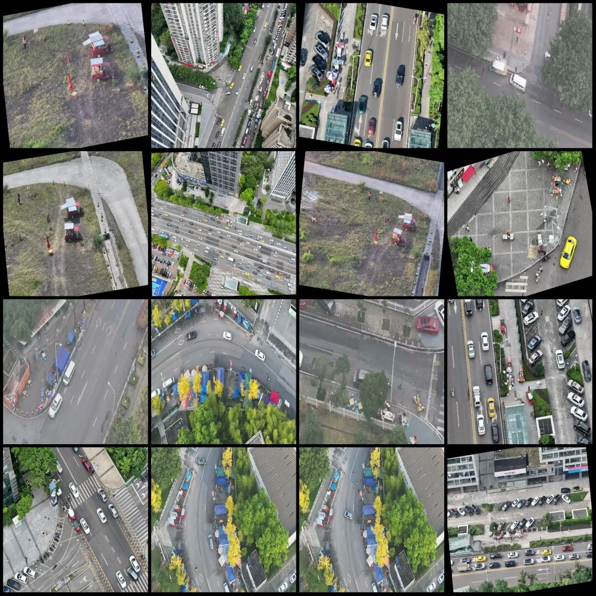
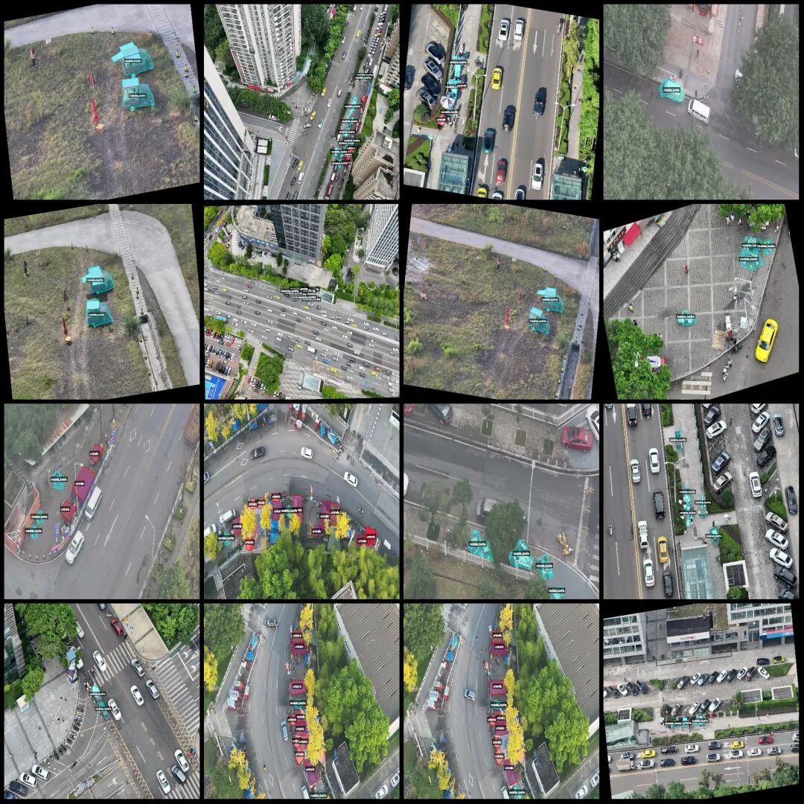
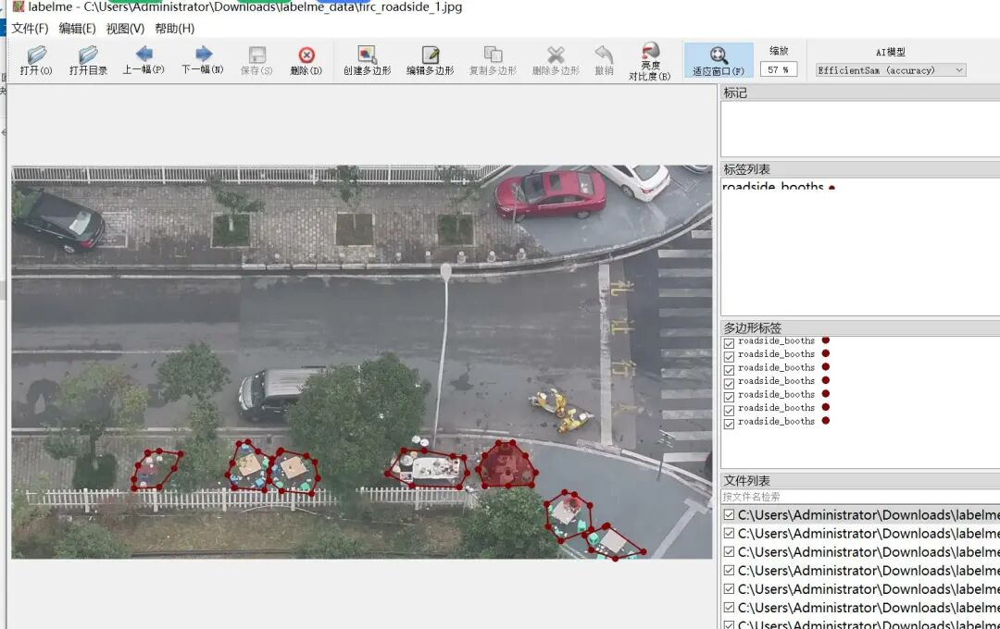

# UAV Perspective City Street Traffic Obstruction Identification and Segmentation Dataset - LabelMe Format: 359 images, 2 categories

Note: Some of the enhanced images in the dataset are primarily rotation enhancements.

Dataset format: labelme format (without mask files, only including jpg images and corresponding json files)

Number of images (number of jpg files): 355

Number of annotations (number of json files): 355

Labeling category count: 2

Label category names: ["roadside_booths", "umbrella"]

Number of boxes labeled in each category:

roadside_booths (traffic management) count = 1453

umbrella (umbrella) count = 655

Total frame count: 2108

Using labeling tool: labelme=5.5.0

Image resolution: 1920x1080

Annotation rules: Draw polygons around the categories.

Important Notice: The dataset can be opened and edited using LabelMe. For JSON datasets, one must convert them into mask or Yolo formats for semantic segmentation or instance segmentation.

Special : This dataset does not guarantee the accuracy of the trained models or weight files.

Image Preview:

Annotation example:

Original image (randomly select 16 images):

Annotation:

LabelMe editing example:

## Payment

Here is a pay link on Stripe ( https://buy.stripe.com/3cs8yP7sY87d0vu9AB ). Please contact me lonlonago@foxmail.com after funding $89, and I will send you a complete data files , thank you!

